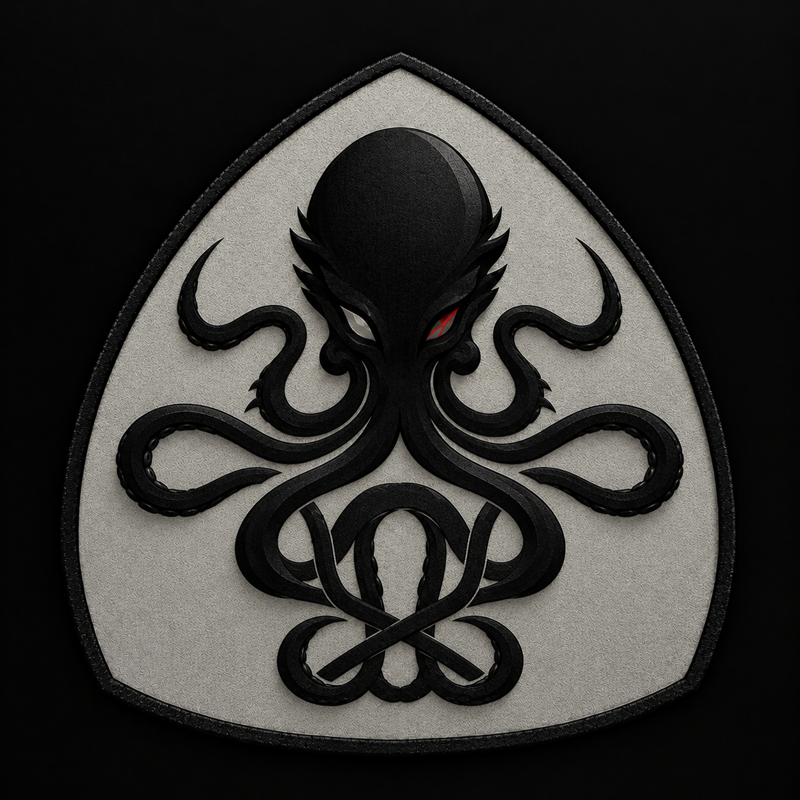

<p align="center">
  
</p>

<h1 align="center">Advassess</h1>

Advassess tests how easily AI models can be fooled or manipulated, and reports the results. You work with it through an AI
agent: the agent writes the assessment config, shows you the plan, runs the attacks once you approve, and reads back the report.

Use it only on models and endpoints you own or are explicitly authorized to test.

## What it does

It runs adversarial attacks against:

- **Image and numeric classifiers**: PyTorch (TorchScript, or weights plus the model class), Keras / TensorFlow (`.keras`, `.h5`)
  and scikit-learn models.
- **Text classifiers**: scikit-learn pipelines that take raw text.
- **Language models**: local or hosted, through Garak (fixed jailbreak and injection probes) and PyRIT (an attacker LLM that
  converses with the target and adapts each turn).

Each run produces a results table, charts, example attack inputs and a self-contained `report.html`. Results list the model's
accuracy before and after each attack, how many inputs were fooled, warnings (for example an attack that changed nothing, which
would otherwise look like robustness), attacks that were skipped, and the limits of the assessment.

Scikit-learn pickles and PyTorch pickles can run code when loaded, so they are refused unless you set
`ADVASSESS_ALLOW_UNSAFE_MODEL_LOADING=1` for a trusted file. Prefer TorchScript or weights.

## Attacks

If no attacks are named, a built-in suite runs, sized to the data and skipping attacks that do not apply to the model.

**Classifiers** (28 attacks from the Adversarial Robustness Toolbox):

| Type | Attacks |
|---|---|
| White-box (use the model's gradients) | FGSM, BIM, PGD, MIM, APGD, ACG, RACG, VAT, Shadow, Composite, Carlini & Wagner (L2, L-inf, L0), DeepFool, NewtonFool, ElasticNet (EAD), JSMA, Wasserstein |
| Black-box (only query the model) | Boundary, HopSkipJump, SignOPT, Square, ZOO, SimBA, Pixel, Threshold, Spatial transformation |
| Mixed | AutoAttack |

Untargeted by default; most attacks also support a targeted mode. Shadow and Composite were not verified during development.

**Text classifiers**: `char_perturb` (misspells the words the model relies on most) and `word_insertion` (appends words typical of
other classes). Both only query the model.

**Language models**:

- Garak: its full probe library, covering jailbreaks, prompt injection, encoding tricks, latent injection, data leakage, toxicity and
  more. Probes are chosen by module, by name or by tag.
- PyRIT: `prompt_sending`, `red_teaming` and `crescendo` (crescendo was not verified during development). Success is judged by a
  canary string or by a judge model.

## Quick install

Requires Python 3.10 or newer.

```bash
python -m pip install --user pipx
python -m pipx ensurepath          # then open a new terminal
pipx install "git+https://github.com/YOUR-USERNAME/advassess.git"
advassess doctor
```

Add the engines you need to the same environment:

```bash
pipx inject advassess torch adversarial-robustness-toolbox matplotlib        # PyTorch and scikit-learn numeric models
pipx inject advassess tensorflow adversarial-robustness-toolbox matplotlib   # Keras / TensorFlow models
pipx inject advassess garak                                                  # language-model probes
```

PyRIT must live in its own Python environment (`python -m venv pyrit-env`, then `pyrit-env/bin/pip install pyrit`), because it and
the Adversarial Robustness Toolbox both install a package named `art` and overwrite each other. The agent points the config's
`pyrit.python` at that environment's interpreter.

## Using it with agents

Advassess runs as an MCP server. One command configures your agents:

```bash
advassess setup --workspace /path/to/your/workspace
```

It supports Claude Code, Codex, Cursor, Gemini CLI and Claude Desktop. It shows exactly what it will change, asks for approval, backs
up each existing config file and edits only its own `advassess` entry. Restart the agent afterwards. Keep your models, data and
results inside the workspace folder. To remove it: `advassess uninstall`.

Then ask your agent in plain language, for example: *"Assess the Keras model in `models/classifier.keras` against the test data in
`data/test.npz`."* The agent will:

1. write the assessment config for you (`write_config`) and describe the plan (`plan_assessment`), including any request counts
   and costs for hosted models;
2. wait for your approval, then start the run in the background (`start_assessment`) and follow it (`get_job`);
3. read back the results (`get_report`) and explain them.

| Tool | Purpose |
|---|---|
| `list_attacks`, `describe_attack`, `list_probes` | What can be run, and each attack's settings |
| `write_config`, `read_config` | Create or read the assessment config |
| `plan_assessment` | Show what would run, without running anything |
| `start_assessment`, `get_job`, `cancel_job` | Run in the background, check progress, stop |
| `list_runs`, `get_report` | Find finished runs and read their results |

API keys are never put in a config: name an environment variable instead, and set it where the agent is started.
